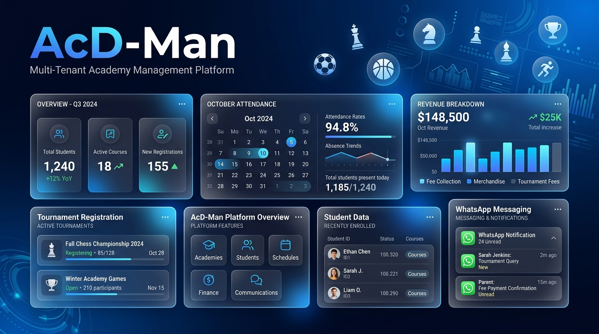
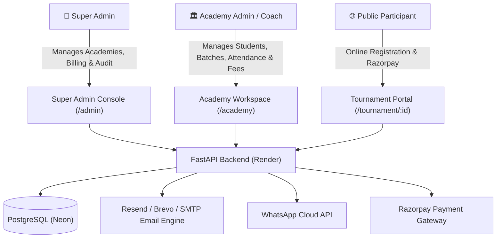

# 🏆 AcD-Man — Multi-Tenant Academy Management SaaS Platform

[](https://flutter.dev)
[](https://fastapi.tiangolo.com)
[](https://www.postgresql.org)
[](https://www.python.org)
[](https://opensource.org/licenses/MIT)

> **AcD-Man** is a production-grade, multi-tenant enterprise software-as-a-service (SaaS) platform built to manage sports academies, chess coaching centers, and educational institutes. It streamlines everything from multi-tenant administration and student rosters to daily attendance, automated branded email invoicing, WhatsApp alerts, and public tournament registrations with payment gateway checkout.

---

<p align="center">
  
</p>

---

## 🌐 Live Deployments & Demos

| Service | Link | Description |
| :--- | :--- | :--- |
| 🚀 **Live Web Application** | [acdmanage.vercel.app](https://acdmanage.vercel.app) | Production client deployed on Vercel |
| ⚡ **Interactive API Docs** | [acd-man.onrender.com/docs](https://acd-man.onrender.com/docs) | Live Swagger API documentation on Render |
| 📱 **Android Release APK** | [Download APK](https://github.com/dhanushmsr/Acadamy-Management) | Standalone release build with offline-ready caching |

### 🔑 Demo Accounts for Evaluation

| Role | Email Address | Password | Permissions & Scope |
| :--- | :--- | :--- | :--- |
| **Super Admin** | `dhanushdsm6351364@gmail.com` | `Sky#Blue99` | Platform tenant billing, academy lifecycle, user audit logs |
| **Academy Admin** | `kannan@gmail.com` | `kannan123` | Full academy operations: students, fees, attendance, tournaments |

---

## 🌟 Key Features & Capabilities



### 1. 🏢 Multi-Tenant Platform Management (Super Admin)
- **Academy Lifecycle Management**: Provision, update, suspend, activate, and soft-delete academy tenant organizations.
- **Platform Invoicing & Billing Alerts**: Create platform subscription bills for academies, mark clearance statuses, and automatically dispatch billing alerts and receipts.
- **System Audit Log**: Real-time audit trail capturing all critical data mutations (entity type, changed fields, old vs. new values, and actor UUID).

### 2. 👥 Roster & Batch Management
- **Smart Parent Auto-Linking**: Adding students automatically looks up and links existing parents by phone number or creates unified parent accounts.
- **Custom Default Tuition Fees**: Set student-specific fee structures and associate students with scheduled training batches.
- **Batch Timetables**: Configure recurring weekly schedules (e.g. `Mon, Wed, Fri • 06:00 PM - 07:30 PM`) with batch capacity tracking.

### 3. 📅 Interactive Attendance & Calendar
- **Daily Attendance Marking**: Swipeable present/absent marking per batch session with instant backend synchronization.
- **Month Calendar View**: High-level calendar showing daily attendance ratios, absence trends, and holiday markings.
- **Student Attendance Records**: Monthly attendance summaries and attendance percentage tracking.

### 4. 💳 Automated Branded Invoicing & Multi-Tier Email Pipeline
- **Dynamic Academy Branding**: Generates responsive, branded HTML receipts dynamically injecting each academy's logo, address, contact details, and custom colors at runtime.
- **Resilient Fallback Pipeline**: Cascades through `Resend HTTPS API` ➔ `Brevo HTTPS API` ➔ `Direct Gmail SMTP` to ensure 100% receipt deliverability even on cloud providers that restrict SMTP ports.

### 5. 🏆 Public Tournament Portal & Razorpay Gateway
- **Public Tournament Landing Pages**: Unique sharable URLs (`/tournament/:id`) with banners, venue maps, tournament rules, and prize structures.
- **Integrated Online Checkout**: Server-side Razorpay order generation, cryptographic signature verification, and automated registration confirmations.
- **Academy Tournament Dashboard**: Real-time registration rosters, participant payment verification, and fee collection summaries.

### 6. 💬 WhatsApp Cloud API Messaging
- **Template Broadcasts**: Integrated with Meta Graph API / WhatsApp Cloud API for official utility template messaging.
- **Targeted Communications**: Send batch-wide announcements, tournament alerts, and fee due reminders directly to parents' WhatsApp.

### 7. 🔒 Enterprise Session Security & Inactivity Protection
- **Inactivity Auto-Logout**: Monitors user interaction and app lifecycle; automatically invalidates active sessions after 30 minutes of inactivity or 15 minutes in the background.
- **Encrypted Device Credential Caching**: Utilizes `FlutterSecureStorage` (AES/Keychain/Keystore) to securely cache credentials on the device for a seamless 1-tap fast re-login experience.

---

## 🛠 System Architecture & Technology Stack

```
├── flutter_app/                  # Cross-Platform Client (Web, Android, iOS)
│   ├── lib/
│   │   ├── core/                 # AuthState, ApiClient, Router, Themes
│   │   ├── features/
│   │   │   ├── academy_workspace/# Home dashboard, People, Attendance, Payments, Tournaments
│   │   │   ├── super_admin/      # Academies, Admins, Audit logs, Platform Billing
│   │   │   ├── tournaments/      # Public Tournament Landing Page & Razorpay Checkout
│   │   │   └── auth/             # Unified Login screen with credential auto-fill
│   │   └── shared/               # Reusable widgets, UI utilities, time helpers
│   └── pubspec.yaml
│
├── backend/                      # Production Backend (FastAPI + PostgreSQL)
│   ├── app/
│   │   ├── core/                 # JWT security, config settings, DB dependencies
│   │   ├── integrations/         # Resend/Brevo/SMTP email engine, WhatsApp Cloud API
│   │   ├── routers/              # 18 Modular REST API routers
│   │   ├── models.py             # Relational SQLAlchemy 2.0 ORM schemas
│   │   ├── schemas.py            # Pydantic v2 validation DTOs
│   │   └── main.py               # FastAPI application entrypoint & live migrations
│   ├── requirements.txt
│   └── render.yaml
│
└── backend-mongo/                # Alternative Backend Track (FastAPI + MongoDB Atlas / Beanie)
```

### Technology Matrix

| Layer | Technologies Used |
| :--- | :--- |
| **Frontend Framework** | Flutter 3.3+ (Dart 3.3+), Material 3 Design |
| **State Management & Routing** | `provider`, `go_router` with centralized route guards |
| **Security & Persistence** | `flutter_secure_storage`, JWT Bearer Token, Bcrypt hashing |
| **Backend Framework** | FastAPI (Python 3.10+), Pydantic v2, ASGI Uvicorn |
| **Database & ORM** | PostgreSQL 16, SQLAlchemy 2.0 (Relational) + MongoDB Atlas / Beanie (NoSQL) |
| **Payment & External APIs** | Razorpay Payment Gateway, Meta WhatsApp Cloud API, Resend HTTPS API, Brevo API |
| **Cloud Hosting** | Vercel (Frontend CI/CD), Render (Backend Web Service), Neon (Cloud PostgreSQL) |

---

## 🚀 Quickstart & Local Setup

### 1. Prerequisites
- Python 3.10+ & Git
- Flutter SDK (3.3+)
- PostgreSQL database (or local SQLite / Postgres)

### 2. Backend Setup
```bash
# Clone the repository
git clone https://github.com/dhanushmsr/Acadamy-Management.git
cd Acadamy-Management/backend

# Create and activate virtual environment
python -m venv venv
# On Windows:
venv\Scripts\activate
# On Linux/macOS:
source venv/bin/activate

# Install dependencies
pip install -r requirements.txt

# Configure environment variables
cp .env.example .env
# Edit .env with your DATABASE_URL and API keys

# Start the FastAPI development server
uvicorn app.main:app --reload --port 8000
```
API will be live at `http://localhost:8000`. Open `http://localhost:8000/docs` for interactive Swagger docs.

### 3. Flutter Frontend Setup
```bash
cd ../flutter_app

# Install Flutter dependencies
flutter pub get

# Run on Chrome / Web
flutter run -d chrome --dart-define=API_BASE_URL=http://localhost:8000

# Or build standalone release APK
flutter build apk --release --dart-define=API_BASE_URL=https://acd-man.onrender.com
```

---

## 📄 License

This project is licensed under the **MIT License** — see the [LICENSE](LICENSE) file for details.

---

## 👨‍💻 Author & Contact

**Dhanush M**  
- **GitHub**: [@dhanushmsr](https://github.com/dhanushmsr)  
- **Email**: [dhanushdsm6351364@gmail.com](mailto:dhanushdsm6351364@gmail.com)  
- **LinkedIn**: [Connect on LinkedIn](https://www.linkedin.com)

*Built with passion for clean code, robust architecture, and delightful user experiences.*
